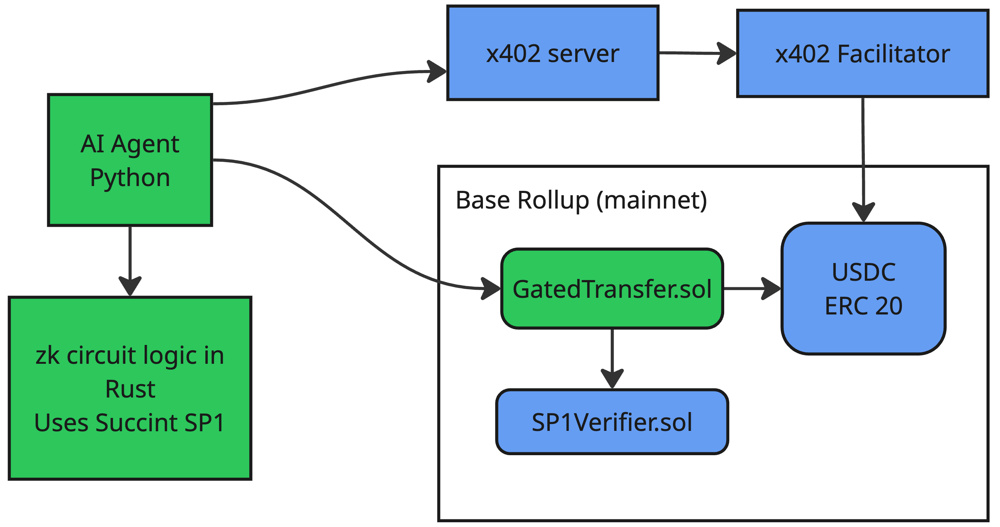

# Zero Knowledge Proof Gated x402 Transactions

This repo contains several projects that combine to deliver a system where x402 transactions only succeed if an AI agent presents a zero knowledge proof to the blockchain showing that the transaction is authorized.

The core idea is that the agent has two blockchain accounts: a treasury account and a payment account. USDC is only transferred to the payment account, thus enabling an x402 service payment, when an action is approved. The approval is proved using a zero knowledge proof.

## Architecture

The [AI agent](./agent) is a command line app written in Python. Given it is deterministic, there are no calls to an LLM, and no tool calling loop. The code simulates what an AI agent tool or guardrail call could be.

The agent calls a public x402 server with no payment to gather payment information from the server. The server returns with a 402 payment required HTTP response code. This payment information is displayed to the user on standard out. The user at this point can exit the app by pressing any character except _y_ or _Y_. 

The agent then creates a [zero knowledge proof](./zkp) locally using Succinct's SP1 framework. 

The agent then submits the zk proof to the [GatedTransfer.sol](./solidity) contract. It uses Succinct's SP1Verifier.sol contract to verify the zk proof. If the proof is verified, the contract transfers the payment amount from the AI Agent's treasury account to its payment account. NOTE: the GatedTransfer.sol contract must be an approved spender of USDC for the treasury account. 

The agent then signs a meta transaction and submits it along with the service request to the x402 server. The server uses a facilitator to submit the transfer of USDC from the payment account to the server's account. The server returns the response to the agent. The agent displays the result to standard out.

## Proofs

The [proof circuit](.zkp/lib/src/lib.rs) is currently limited to checking that an address is within a set of agreed addresses, and not the USDC contract address (0x833589fCD6eDb6E08f4c7C32D4f71b54bdA02913). 

The circuit has a check for payment amount to restrict the calls to services costing less than or equal to US$0.01. Additionally, there are other values to prevent replaying of a proof.

The parameters are:

| Input | Visibility | Rule |
| --- | --- | --- |
| To be checked address | Private | Must be in the list of addresses, and must not be `0x833589fCD6eDb6E08f4c7C32D4f71b54bdA02913` |
| Chain ID | Public | None in the circuit. [GatedTransfer](./solidity) only accepts its own chain's ID |
| Nonce | Public | None in the circuit. GatedTransfer accepts each nonce once |
| Issued at | Public | None in the circuit. GatedTransfer rejects a proof issued in the future, or older than its time limit, which is 10 minutes by default |
| Payment amount | Public | Must be less than or equal to 10000 (US$0.01) |

## Limitations

* The x402 service request are not linked to the generated proof. That is, the service request is either a HTTP GET or POST. For HTTP GET a URL is specified. For HTTP POST a URL and JSON encoded parameters are specified.
* The GatedTransfer.sol contract is linked to a single AI agent and its associated treasury and payment accounts. In particular, transfer transactions must be submitted by the payment account.
* At present, the agent code does not call the zk proof code, and hence does not used GatedTransfer.sol.  