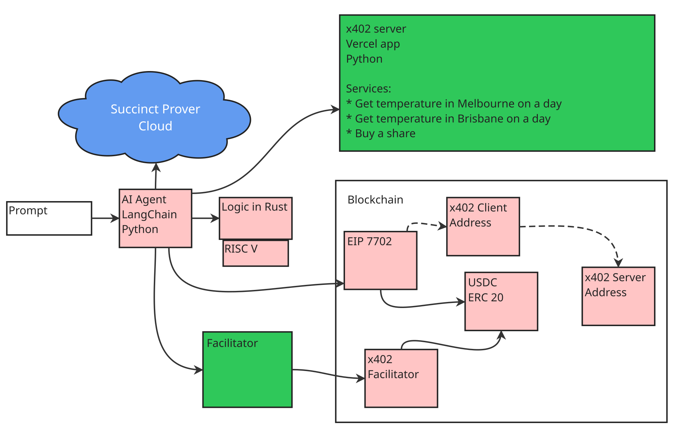

# Zero Knowledge Proof Gated x402 Transactions

This repo contains several projects that combine to deliver a system where x402 transactions only succeed if an AI agent presents a zero knowledge proof to the blockchain showing that the transaction is authorized.

## Architecture

A user uses a command line application that simulating an AI agent (python code in the [agent](./agent) directory). The agent gets payment information from an x402 server. The x402 server responds with payment information. The user approves the payment. The agent creates a zkp using some rust code and Succinct's SP1 [zkp](./zkp). The prover is run locally. The agent submits a transaction to Base blockchain with the proof to a contract that transfers some USDC from the agent's primary account to its payment account. The agent then submits the x402 transaction to the server, that then forwards it to the facilitator, that executes the payment. The agent then displays the returned information.

TODO discuss zkp rules:

- Spending limit

